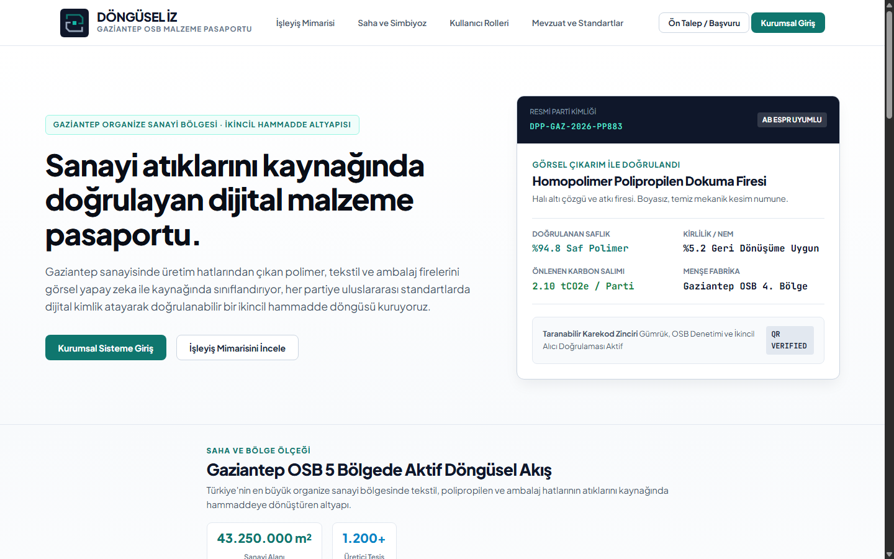

<div align="center">

# Döngüsel İz
### Endüstriyel Simbiyoz ve Dijital Malzeme Pasaportu Platformu

<p align="center">
  
</p>

<p align="center">
  Organize Sanayi Bölgelerinde atık malzemelerin çapraz sektörler arasında ikincil hammaddeye dönüştürülmesini sağlayan, dijital ürün pasaportu üreten ve karbon salımını şeffaf şekilde belgeleyen kurumsal ekosistem.
</p>

<p align="center">
  <a href="https://donguselizweb.celikcelik156.workers.dev/" target="_blank">
    
  </a>
  
  
  
  
</p>

</div>

---

<div align="center">
  <h3>Canlı Sistem Ekranı</h3>
  <p>Cloudflare Workers ve bağımsız istemci üzerinde 7/24 kesintisiz çalışan kullanıcı arayüzü</p>
  <a href="https://donguselizweb.celikcelik156.workers.dev/" target="_blank">
    
  </a>
  <p>
    <b>Canlı Bağlantı</b> <a href="https://donguselizweb.celikcelik156.workers.dev/">donguselizweb.celikcelik156.workers.dev</a>
  </p>
</div>

---

<div align="center">
  
</div>

## Sistemin Çözdüğü Sorun

Sanayi tesislerinin üretiminde ortaya çıkan yan ürünler ve atıklar çoğu zaman çöpe gitmekte veya çok düşük bedellerle bertaraf edilmektedir. Döngüsel İz, bir fabrikanın atığını diğer sektördeki fabrikanın hammaddesine dönüştürür. Süreci uçtan uca dijitalleştirerek karbon salımını düşürür ve kaynak verimliliği sağlar.

```
+---------------------+        +------------------------+        +---------------------+
|   Atık Üreticisi    | -----> |   Döngüsel İz Motoru   | -----> |  Hammadde Alıcısı   |
|   Tekstil Fabrikası |        |  Yapay Zeka ve Takip   |        |  Yalıtım Fabrikası  |
+---------------------+        +------------------------+        +---------------------+
```

---

<div align="center">
  
</div>

## Temel Yetenekler

### Görsel Yapay Zeka ile Otomatik Analiz
Sisteme yüklenen malzeme numunesi fotoğrafları görsel yapay zeka modelleriyle taranır. Malzemenin cinsi, saflık oranı, yabancı madde yüzdesi ve uygun sanayi kategorisi saniyeler içinde otomatik tespit edilir.

### Dijital Malzeme Pasaportu
Her parti atık için benzersiz doğrulama koduna sahip bir dijital pasaport üretilir. Malzemenin teknik özellikleri, geri dönüştürülebilirlik oranı ve önlenen karbon salımı kayıt altına alınır.

### Çapraz Sektör Simbiyoz Eşleştirmesi
Farklı sektörlerdeki firmaların hammadde ihtiyaçları taranır. Tekstil artıklarının akustik yalıtıma, polimer kırıklarının plastik enjeksiyon sektörüne yönlendirilmesi gibi katma değerli eşleşmeler sistem tarafından önerilir.

### Karbon Ayak İzi ve Sürdürülebilirlik Raporu
Geri kazanılan malzeme miktarı, önlenen karbon emisyonu ve tasarruf edilen doğal kaynak verileri firma bazında grafiklerle raporlanır.

---

## Proje Yapısı

Platform iki tamamlayıcı bileşenden oluşur.

### DonguselIz.Web
Kurumsal kullanıcı panellerini, üyelik sistemini, atık pazar yerini ve arka plan analiz servislerini barındıran tam teşekküllü web platformudur.
- ASP.NET Core MVC altyapısı
- Entity Framework Core ve SQLite veri tabanı
- Groq Vision servis katmanı
- Rol bazlı yetkilendirme ve oturum yönetimi

### DonguselIz.Studio
Cloudflare Pages ve sunucusuz mimariler için optimize edilmiş hafif istemcidir.
- Kurulum veya harici derleme gerektirmez
- Cloudflare Workers üzerinden canlı yayındadır
- Hızlı prototipleme ve bağımsız kullanım imkanı sunar

---

## Yerel Kurulum

Projeyi bilgisayarınızda çalıştırmak için aşağıdaki adımları takip edebilirsiniz.

1. Depoyu klonlayın
```bash
git clone https://github.com/mehmetcelikcmyk/Dongusel-iz.git
cd Dongusel-iz
```

2. Web projesi klasörüne geçin
```bash
cd DonguselIz.Web
```

3. Bağımlılıkları yükleyin ve uygulamayı başlatın
```bash
dotnet restore
dotnet run
```

4. Tarayıcınızdan yerel adrese gidin
```
http://localhost:5000
```

---

<div align="center">
  <p>Döngüsel ekonomi ve sürdürülebilir sanayi için geliştirilmiştir.</p>
</div>
